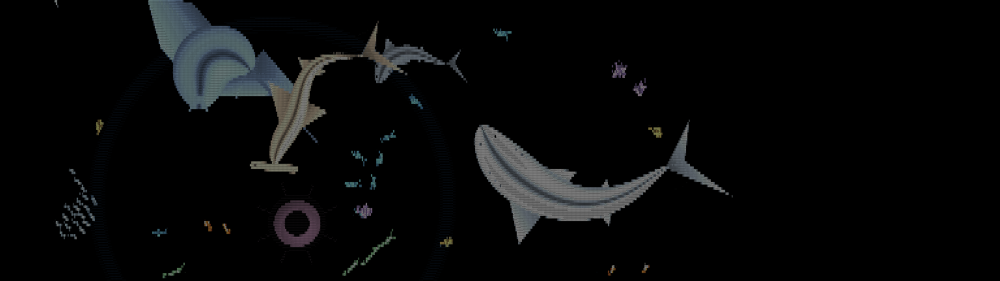
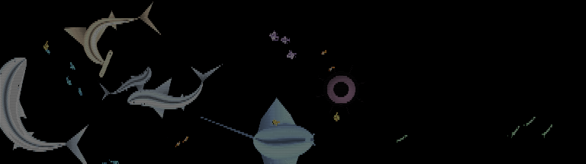

# Ascii Screen

A live ocean made of letters, for your Windows desktop. Sharks, a hammerhead, a manta ray, a jellyfish and schools of six kinds of fish swim as shaded tiles of ASCII characters, behind your desktop icons on every monitor.




It comes in three forms that share one renderer:

| | What it is |
|---|---|
| **Live wallpaper** | The ocean is drawn *behind your desktop icons*, spanning all monitors. Your mouse scatters the fish and a click sends a ripple. |
| **Desktop overlay** | A click-through layer so the creatures swim over your open windows. |
| **Screensaver** | `AsciiSaver.scr`: the ocean, plasma, tunnel, fire, a photo slideshow, or your live desktop turned into ASCII. |

## Features

- **Procedural creatures**, no sprites: each body is a spine with a width profile, fins and a tail, with a travelling swimming wave from snout to tail, banking in turns and smooth speed changes.
- **Six fish species** with their own shapes, patterns and swimming styles: sardine bait balls, angelfish, needlefish, pufferfish, clownfish and mackerel.
- **Behaviour**: schools keep together and keep apart from each other; sharks hunt schools; the manta glides through them; bait balls tighten, swirl and scatter near a shark.
- **Depth**: far creatures are smaller, fainter and slower.
- **Interaction**: the cursor scatters fish and one shark comes to look; clicking sends a ripple (optional).
- **Windows 11 settings window** (Fluent theme, light and dark) with a live preview that changes the running wallpaper instantly.
- **Light on the CPU**: roughly a third of one core on two 1080p monitors.
- Honours the Windows "Animation effects" setting (shows a still scene when it is off).

## Requirements

- Windows 10 or 11 (developed and tested on Windows 11).
- To **build**: Windows PowerShell, the .NET Framework 4 compiler (`csc.exe`, already part of Windows), and the **.NET 10 SDK** if you want the Windows 11 style settings window (without it the app falls back to a plain built-in settings window).
- To **run** the settings window: the .NET 10 desktop runtime.

## Build and install

```powershell
git clone https://github.com/carlosnunez09/ascii-screen.git
cd ascii-screen
powershell -ExecutionPolicy Bypass -File .\build.ps1      # builds AsciiSaver.scr, AsciiScreen.exe, settings-app\
powershell -ExecutionPolicy Bypass -File .\install.ps1    # copies to %LOCALAPPDATA%\Programs\AsciiScreen and puts a shortcut on your desktop
```

`install.ps1` stops any running copy, installs the files, and creates an **Ascii Screen** desktop shortcut that starts the live wallpaper. It does not change your Windows screensaver setting; to use the screensaver, right-click `AsciiSaver.scr` and choose **Install**.

There are no prebuilt binaries yet. The executables are unsigned, so Windows SmartScreen may warn you if you share a build.

## Using it

| | |
|---|---|
| `AsciiScreen.exe` | Opens the ocean in a window |
| `AsciiScreen.exe /wallpaper` | Live wallpaper (what the shortcut runs) |
| `AsciiScreen.exe /overlay` | Click-through desktop overlay |
| `AsciiScreen.exe /settings` | Opens the settings window |
| **Ctrl+Alt+W** | Toggle the live wallpaper from anywhere |
| **Ctrl+Alt+O** | Toggle the desktop overlay from anywhere |
| Tray icon | Double-click for the window; right-click for the menu (settings, colours, exit) |

Settings (colour, letter size, swim speed, fish amount, number of sharks, manta ray and jellyfish, ripples on mouse click, start as wallpaper or overlay, start with Windows) are saved to `%APPDATA%\AsciiScreen\settings.ini` and applied live to the running app.

## How it works

`AsciiSaver.cs` is the shared core and is compiled into all three programs:

- `Engine` turns a grid of colours into a frame of letters: it picks a letter by brightness and draws each bright cell as a shaded tile with a dark letter and a hairline gap.
- `OceanSource` simulates and draws the creatures into that grid.
- `OceanApp.cs` is a native Win32 app (own window class, message loop, GDI, tray icon, hotkeys). Wallpaper mode makes its window a layered child of the desktop window (`Progman`), between the icon layer and the wallpaper layer.
- `AppSettings.cs` holds the saved settings; `settings-ui/` is the WPF settings window, which links `AsciiSaver.cs` to run the same ocean in its preview.

See [AGENTS.md](AGENTS.md) for the layout, build and test commands and the constraints to respect when changing the code.

## Privacy and safety

No network access, no logging, no telemetry. The overlay and wallpaper modes read the system-wide cursor position and left-button state so the creatures can react; nothing is stored or sent. **Start with Windows** is opt-in and only writes a per-user `Run` registry value, which turning the option off removes.

## Known limits

- Windows only. The live wallpaper layering is tested on Windows 11 build 26300; the older (pre-24H2) desktop layout is handled in code but untested.
- The overlay covers the primary monitor only; the wallpaper spans all monitors.
- Behaviour and animation are verified mostly from rendered frames and measurements, not long live runs.

## Contributing

Contributions are welcome, **including AI-assisted ones**. Read [CONTRIBUTING.md](CONTRIBUTING.md) first. Changes to `main` go through a pull request that needs a passing build and the maintainer's approval.

## Credits

The look is inspired by the ocean component of [asciify.org](https://asciify.org) (`asciify-engine`); no code from it is used. This project was built with the help of AI coding assistants (Claude Code and OpenAI Codex) under human direction.

## License

[MIT](LICENSE) © 2026 Carlos Nunez
